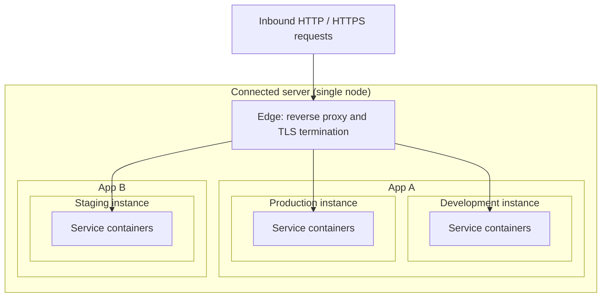

# Single-server infrastructure

## Overview

When you connect a server to Wodby 1, Wodby installs a single-node, container-based infrastructure used to deploy your applications and stacks.

Wodby 1 currently supports only single-node setups. For scalable clusters, we recommend Wodby 2. See [Cluster](cluster.md) for details.

Infrastructure and stacks are versioned and maintained separately. Infrastructure updates can include operating-system compatibility, security fixes, and component upgrades.

* [Infrastructure maintenance](maintenance.md)
* [Update infrastructure from the Dashboard](maintenance.md#updating-from-the-dashboard)
* [Stacks maintenance](../stacks/maintenance.md)

The infrastructure is powered by Docker and Kubernetes. The Wodby Agent applies operations requested by the Wodby 1 backend, and Edge terminates TLS and proxies public traffic to application services.

## Infrastructure generations

### Infrastructure 7

Infrastructure 7 is the default for newly connected servers. It supports fresh Ubuntu 26.04 and Debian 13 amd64 hosts and modernizes the container, Kubernetes, networking, Agent, and Edge platform. It improves application security through safer credential and configuration handling, tighter platform permissions, and inbound network isolation between applications while preserving normal outbound connectivity.

Infrastructure 7 is not an in-place upgrade for Infrastructure 6. To move an existing server to Infrastructure 7, connect a fresh supported host and migrate or redeploy the applications to it.

#### Connections between instances

On Infrastructure 7, the services of an instance accept connections only from the same instance and from Edge. Another instance on the same server, of the same app or a different one, can't connect to them through their internal hostname. Infrastructure 6 doesn't isolate instances, so check these connections before you move apps to Infrastructure 7.

To use a service, such as Solr or Redis, from another instance on Infrastructure 7, do one of the following:

- Add the service to the stack of the instance that uses it.
- [Publish the service's port](../stacks/config.md#ports) and connect to the published address: the technical domain for an HTTP port published through Edge, or the server's IP address and the generated port for a TCP port. If the server is behind NAT and its public IP address doesn't work from the server itself, use its private IP address.

A published port accepts connections from anywhere your firewall allows. Protect the service with a password, and allow only the addresses that need it in your firewall.

### Infrastructure 6

Infrastructure 6 is the legacy line used by existing Wodby 1 servers. Do not run the Infrastructure 7 installer on an existing Infrastructure 6 server.

See [infrastructure maintenance](maintenance.md) for the current release profiles and upgrade policy.

## Schema

Edge is a reverse proxy container based on nginx. It proxies requests to application instances, performs configured redirects, and terminates TLS.

The example below shows two apps with three isolated instances on one connected server. Edge routes incoming HTTP and HTTPS requests to the appropriate instance's services.

Instances of the same app can also run on different connected servers. See [App model](../apps/app-vs-instance-vs-service.md) for how apps, instances, and services relate.
